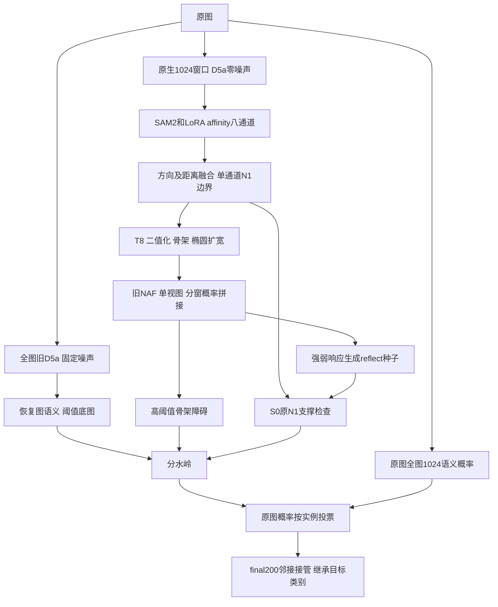

# 当前部署的端到端优化审查

2026-10-31执行回报：[窗口/方向与合并后复票检查](NAF_CHECKS_20261031.md)已完成。113个接管目标0翻类；4源8ROI旧C概率及4个方向identity均exact，登记断口最高单窗仍未补通。方向均值明显改变幅值，未接入读出；下一训练候选仍为双输入NAF，尚未实施。以下保留研究时点的逐项计划，不将局部方向诊断写成完整TTA部署验证。

2026-10-31。本轮为源码、已有实验和原始论文/作者实现审查；没有SSH、模型前向、训练或新出包。

## 总判断

优先研究信息如何被使用，再考虑增加容量或延长训练。
当前可验证的事实是连续/方向信息多次被压缩，部分监督与最终实例目标不等价；
这些不是已证错误，既有简化也能过滤噪声，不能由“丢了信息”直接推出“保留就一定更好”。

研究控制C为N1局部零噪声＋旧20a59 NAF＋S0＋final200，已报两项.7461／.9070；
旧final50的.7467／.9058也保留。只按本赛段同公式比较，不拿复赛旧mIoU横比。
新公式按全部GT及同类一对一匹配计分，未匹配FP不直接扣实例项；
P直接合并FP净少1488但TP少121是明确反例，不能继续拿“数量更少”当纠错证据。

## 实际调用链

这是调用路径，不表示重复保存了多个独立encoder。实际bundle是否启用semantic_lora，
现有本地元数据未能确认；不得由源码默认构造或存在同名文件作结论。
全图affinity在patch1024分支未用于融合，但全图恢复语义确实影响WS底图；
raw重投仅覆盖类别，不会撤销它对几何的影响。局部前向已只运行affinity，无每窗冗余语义可删。

## 逐段机会与排序

| 环节 | 现有证据/限制 | 值得的改动或检查 | 优先级 |
| --- | --- | --- | --- |
| GT与采样 | 原标、filled同权进入部分目标；当前NAF固定配对约80%正点为filled，但非全训练梯度比例 | 先审计真实小批各来源/天然缺口梯度，再决定分层权重；不补标、不新留出、不整体换伪GT | 次级机制检查 |
| D5a | 当前局部N1已去噪声，原生尺度恢复适配/强模糊输入未证明普遍增益 | 继续冻结；全图去噪可作复现简化，评分收益优先级低 | 暂缓新训 |
| 原生视野 | 768在旧N0同坐标热图有局部得失，未完成当前N1＋NAF真实读出 | 固定权重与其余逻辑，单独比较1024和768；各分支S0参考自身未经NAF边界 | 次级无训练候选 |
| encoder/LoRA | 仅32标图，旧冷启动跳过Stage1/joint-v3，不能据此判原流程无效 | 暂不换大encoder/全网重启；专属LoRA须先核完整依赖并保留阶段路径 | 暂缓结构重训 |
| 八路affinity压缩 | 短距top2、长距门控后合为一幅图，方向/端点不再保留 | 有界原关系图读出；不是重新删长程权重 | 较大的结构后备 |
| NAF输入 | T8使.49和.01同为0；现有raw字段其实也已二值化 | 输入改为T8＋连续N1，保留其余配方 | 首选新训练 |
| NAF滑窗/对称性 | 有全局空间均值注意力；单视图概率拼接；作者另有D4票决 | 先归因单窗/重叠窗/旋转翻转的差异，有信号才做候选读出 | 首选无训练诊断 |
| NAF监督形态 | 容差max能覆盖点，却允许双峰、宽带、局部小环 | 安全单界面走廊的单主脊剖面目标；先验证合成反例及梯度 | 后备训练 |
| 种子与WS | 已查当前9图硬种子约占95.84%；WS非连续NAF标量高程，K1/F0已测未稳定收益 | 真标量高程单独做求解器桥接；不重新包装缩种子/删语义底图 | 低优先级 |
| 原图语义投票 | whole1024；final200后继承旧目标类 | 先独立检查吸收目标的合并后复票；纯语义两视图TTA另列 | 便宜检查 |
| final200并给谁 | 仅最长接触/面积/ID选邻居，不读边界证据 | 固定<200候选和原>=200目标，仅换接管邻居排序 | 便宜读出后备 |

上述所有“未执行”均指未找到当前C上的完整独立对照；不是宣称历史从未讨论。

## 首选新训练：T8与连续N1双通道

假设：当前输入混淆了“接近阈值的弱响应”和“几乎没有证据”，不必再让RGB/更大网络重新猜。
它保留了已有N1置信幅值，但不承诺这些幅值已校准或能区分真弱边与噪声。

- 只增加连续B信息，公共参数从原共同随机初态重建；不继承训练后的20a59。
- 优先保留原单通道T卷积及内存布局，另加无bias、零初始化的B卷积支路相加，约增加432参数；避免直接扩宽卷积触发不同GPU归约。
- 输出logit跳连仍只取T8。关闭新支路应走原路径并桥接最终概率/实例；开启但全零时另核实际数值与最终输出，不由参数为0推断逐bit兼容。
- 旧公共结构、PixelShuffle、GAN、损失、32源、16000 draw、batch和1000更新保持。新增支路不得打乱公共随机参数，需核完整初态SHA。
- 读取既有原N1浮点热图，不重新运行D5a/encoder；原图、GT、裁窗、D4、unknown合同保持。
- `data/boundary_rgb.py:207`的raw_input_boundaries实际上是B>=.5，不能误当连续B。
- `models/boundary_rgb.py:59`及`:76`的输入二值/跳连合同需显式新版本，不能放宽旧断言或伪装RGB模式。
- 配对比较必须同clean输入/同读出；测试增强、原标filled权重、TTA和新loss都不叠加。
- 保存固定过程缩略图；先通过存载/输入对齐/关闭兼容/学习性，再正式1000更新。

若缺少可验证补边收益，且预封可信区域明确误切或完整界退化，则不续训/晋级；
GT未知区、单纯切分更多或计数上升不能独立否决，也不因训练loss低继续扩训。

## 首选无训练诊断：窗口与D4的响应归因

先用现有T8缓存，固定少量当前测试ROI与已见原标裁块，不只盯历史116。
同一像素分别记录各重叠窗预测、原权重融合结果。方向敏感性另固定同一个256裁块，
做旋转翻转后逆对齐；整图D4同时改变滑窗格点/上下文，只能评价部署TTA的整体影响，不能全归因方向不等变。
区分所有窗均弱、只有部分窗有响应、融合后才跌阈值、稳定存在的多轨与小环。
这能回答失效发生于网络还是融合，但无标签ROI仍不能验证补线正确性。

Dual-CGB作者[test.py](https://github.com/n-okt/Dual_CGB/blob/main/test.py#L45-L111)
实现了D4和重叠二值票；[316L配置](https://github.com/n-okt/Dual_CGB/blob/main/config/test/316L_Grains.yaml#L11-L28)
启用test_data_aug。本项目`tools/boundary_rgb_monitor.py:67`是单视图概率加权，
这项区别旧文档已记录；研究初稿时尚未找到当前C上的独立试验，后续已完成上述固定裁块归因，未执行完整D4候选读出。

若尝试TTA，先仅同旧20a59逐视图前向/逆变换后概率均值，固定其余读出，identity须exact。
全图T8只规范化一次，避免8核偶数anchor被重复规范化改变坐标；逐视图累积，不堆叠8份全图。
平均可能压掉真正弱峰，不能预设一定清噪，更不能默认max融合好。
作者边界黑/内部白，tau .8为内部二值票比例，不是本项目边界概率阈值.8；不照抄。

TLC的[原论文](https://arxiv.org/abs/2112.04491)研究训练裁块/推理大图的全局聚合错配，
但本项目NAF两侧均256，因此不能直接套其病因或宣布应启用TLC。
单窗常数输入已呈周期起伏，拼接也不能解释所有伪影。

## 便宜末端检查：投票时机与接管目标分别消融

当前`tools/infer_semifinal.py:324`在raw投票后执行final200，
`utils/final_instance_cleanup.py:164`按接触选邻居，`:199`明确继承类、不重投。
这是有意保留的合同，不称现有bug。

第一项：固定原C最终PNG及合并映射，只对真正吸收小区的target_id用原float32 raw概率重投，
其余类别exact。不改变任何几何、过滤资格、网络或阈值；先看真实双向翻转及涉及面积。
几乎无翻转则停止；即使几何不变，F数和F均面积仍会受类别翻转影响，不保证面积守住。

第二项：固定<200资格、原>=200邻居、图框/连通限制、一次映射及继承类，
只比较最长接触与共享分隔证据最弱的接管排序。先做±1px采样稳定性，
尤其防NAF点阵使排名抖动；原N1与NAF证据也不能随意混合成新调参器。

纯语义TTA必须在pre200实例上投票再套同一200映射；
直接在最终PNG上重投会同时改变投票时机，identity未必复现C，不可全算给TTA。
两视图仅身份＋水平翻转，逆对齐后固定一种合并方式；当前tta标记并不被此路径读取，不能只改flag。

## 较大的结构方向：直接关系划分

八通道offset为(0,1)、(1,0)、(1,1)、(1,-1)、(0,2)、(2,0)、(0,4)、(4,0)。
`utils/affinity_fusion.py:76`先将短四向断开概率取top2均值，再以短边支撑门控长程修正。
长边参与，并非全部被删；旧距离消融也发现其同时抑制假边、压弱真边，不能简单去长边。

可研究[MWS原论文](https://openaccess.thecvf.com/content_ECCV_2018/html/Steffen_Wolf_The_Mutex_Watershed_ECCV_2018_paper.html)：
它利用同组吸引与分组排斥，避免预先给每个实例找一个种子。
这是可能减少NAF/种子堆叠的结构方向，不保证当前八路概率可直接当其标准排斥边。
有监督旧图重建主要使用GT前景/dummy类别，仅为Oracle诊断；无监督MWS的结果也不等价当前权重。

先在单个小网格保证边端点坐标与offset映射正确，全像素读出、不借GT前景，GT只事后对照；
不能将八张概率图分别双线性放大就称为原生关系图。随后才处理跨窗关系/置信标定。
[Semantic MWS论文](https://arxiv.org/abs/1912.12717)还给出划分与类别联合图优化的路线，
但当前粗语义可能把错误传播到几何，故先纯几何、固定raw投票，不能同时耦合两头。
此项成本和改动范围高于双通道NAF，不作为临近截止时第一个大工程。

## 执行顺序与资源边界

1. 先做不训练的合并后复票检查、NAF窗口/D4归因，两者独立不叠加；有实质动作才最终小样本读出。
2. 新训练只优先双通道NAF；768视野留作独立无训练候选，不与新NAF同时改。
3. 分层梯度审计、单主脊loss和完整图读出留后备，前项不成立时不无穷追加模块。

不再优先重做强RGB模糊、原样擦断、多轮NAF、去GAN/换上采样、K1/F0、H0或相邻P全合并。
这些已有实测反例或官方未获净收益；不能靠更平滑/更少实例晋级。

后续实验前先核快盘预算，预留10GiB及新增checkpoint空间；不足时明确冷备并核SHA后清理封存权重，
活动目录仍在`autodl-tmp/seg/supervised/runs/`，FS不承接训练/过程图。
CPU统计与GPU前向解耦，先微型布尔掩码/shape检查，再以独立内存上限和PID回执运行；
不使用全图×视图/样本堆叠，不恢复之前中断的13例GT统计。
全部候选严格对原C比较；只有官方新回分或既定完整部署门槛才能晋级，保留最高分包。
