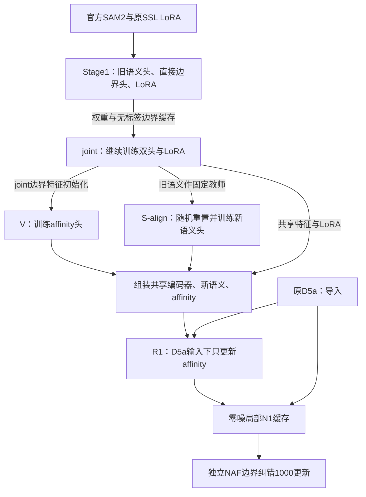

# 教师GT32训练链：参数传递、冻结与最终去向

2026-11-01终态：[结果及逐阶段耗时](TRAINING_RESULT_TEACHER32_20261101.md)已核验，13阶段全部完成、08:08正常退出；本轮导入SSL/D5a后的端到端用时5小时46分23秒。下文静态依赖说明保留，阶段必要性与官方效果仍分别验证。

2026-11-01后续：[V6及未使用语义边界缓存已移出默认入口](V6_ELISION_20261101.md)。13阶段的代码、CPU和CUDA桥接已通过；原joint继续，完成后自动核验并接续，后半段尚未开始。

2026-11-01。按本地当前入口、教师配方及实际训练器静态核对；未查询服务器进度，未改变正在运行的训练。
本轮生成/启动记录见[教师GT演习](TEACHER_C32_REHEARSAL_20261101.md)，详细参数见[训练参数总表](TRAINING_RECIPE_20261101.md)。

报告附录文字已整理为[附录A 完整训练流程与权重来源](REPORT_APPENDIX_TRAINING_20261101.md)，区分历史已评分模型与当前教师重训，供报告正文引用。

## 数据与两种教师

- 已评分旧C先对允许的32训练源生成固定实例/类别GT；这是本轮新监督，原GT保留，测试图不参加。
- 原1000训练图用于无标签学习；原64源SAM2仅给无类别几何关系。
- S-align还有一位本轮内部固定教师：直接复制joint语义，提供无标签图概率约束。它与生成32硬GT的旧C不是同一份模型。
- 原SSL LoRA与D5a不依赖分割GT，本轮显式导入；其余监督参数重新建立，不加载旧C的监督权重。

## 主链

图为权重依赖，统一入口当前仍顺序执行各阶段。

| 阶段 | 预算 | 更新与保留 |
|---|---|---|
| SSL | 本轮导入 | 原RGB遮挡重建产生的LoRA；重建头不部署 |
| Stage1 | 100轮 | 官方骨干冻结；随机旧语义/边界双FPN与LoRA共同学习；另生成1000图边界缓存 |
| joint | 100轮 | 接续双头与LoRA；保留最终共享特征及供V初始化的边界FPN，直接提供S-align固定语义教师 |
| S-align | 20轮 | 先复制固定旧语义教师，再重置学生完整语义路径；只训练新语义，LoRA/边界冻结；监督为教师GT32及1000图旧语义概率蒸馏 |
| V affinity | 120轮／3120计划更新 | FPN从joint边界FPN严格复制；新上采样/八方向输出随机；只更新affinity；教师32＋SAM64 |
| D5a | 本轮导入原e60 | 原1000图RGB自监督恢复，分割GT未用于该原训练 |
| R1 | 20轮／1280更新 | 组装本轮joint特征、S-align语义与V；D5a恢复输入；whole/native1024各半；只更新affinity，编码器/语义/D5a冻结 |
| N1缓存＋NAF | 32源局部缓存；NAF1000更新 | 新backend/D5a实际零噪局部推理、重叠拼接边界；NAF输入来自缓存，目标来自固定教师32，独立训练生成器/判别器 |
| 导出验收 | 不训练 | R1后先导出backend/restorer供N1；NAF后仅导出生成器，检查三份模型的身份/参数预算 |

早期语义有标签训练采用1024等比整图后512裁块，无标签语义一致性使用整图1024；不是只有全图训练。
S-align不经D5a训练；R1只适配affinity，不能声称语义也接受D5a域微调。
R1恢复仍保留历史带种子随机噪声first-x0训练工况；N1缓存和当前部署为显式zero，两者不混写。
NAF目标中语义/affinity的ID0仍ignore，明确轴向单像素A-0-B可派生边界监督；不填改实例/类别数组。

## 旧头到底留下什么

旧语义不直接导出，但Stage1/joint语义损失训练LoRA，S-align先复制旧语义作固定教师、再重置学生。历史上生成V6边界伪标签的路径已随V6删除。
S-align蒸馏仅读教师语义通道，置信度门槛.9、概率MSE权重.12→.03/12轮；旧教师不随学生更新。
当前语义路径使用GroupNorm，没有BN运行均值/方差buffer；不能把通用重置函数的BN兼容分支说成当前旧头统计残留。
旧边界预测器不进入最终backend；joint边界FPN通过V初始化间接保留。最终backend仍只有语义和affinity两个任务头。

最终权重来源：官方SAM2＋joint LoRA＋S-align新语义＋R1后affinity；另配原D5a和本轮新NAF生成器。
SSL重建头、旧语义教师、旧直接边界预测头及NAF判别器均不部署。

## 已删除的历史V6步骤

V6只改变旧边界；V从joint初始化，S-align只蒸馏语义、不使用V6边界损失，最终导出不带旧边界。
因此原静态依赖图没有V6新学边界的最终消费者，V6没有向最终模型提供任何新训练的有效参数。旧e9只是将joint已有的语义和LoRA经另一个文件传给S-align；这是现已从默认入口清除的历史文件依赖，不是V6训练必要性的依据，不能解释成“训练了更好的语义教师”。
并且`artifact_paths`只将V6 e9交给下游，第10～60轮的新权重没有下游读取。
e9是沿用的固定载体索引，没有根据新GT重新评选；不能称为本轮最优语义轮次。真正的上游joint已按新GT验证综合指标重新选best，S-align也按新GT验证loss重新选best，不固定历史采用epoch。joint综合权重为语义.2/边界.8，其best不保证教师语义单项最优。
默认已删除V6及其缓存；旧15阶段仅供显式legacy兼容。删除依据是计算依赖，与GT版本无关；已做的CPU/GPU仅为实现回归抽查，不能证明新GT训练效果或整程轨迹等价。joint结束后核来源和加载兼容便直接接续，不再重复GPU抽查。完整训练和最终部署尚未验收，见[删减记录](V6_ELISION_20261101.md)。

关键来源：`repro/pipeline.py::artifact_paths/STAGES`、`repro/current_early.py::build_stage`、
`train_stage2.py::main/build_teacher_model/set_student_train_modes`、`utils/loss_semi.py`、
`models/backend_adaptation.py::build_backend`、`repro/current_backend.py`及`repro/current_naf.py`。
